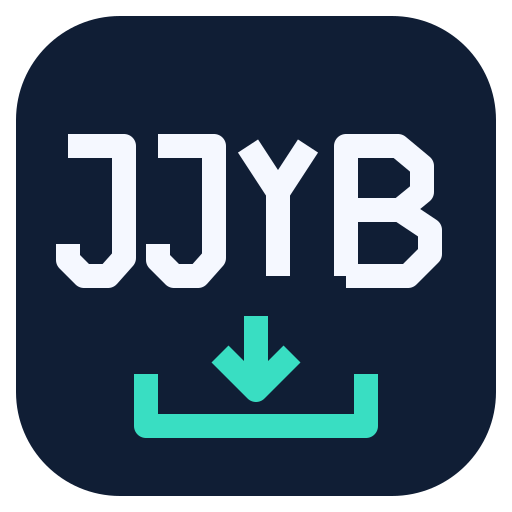

<p align="center"></p>

# JJYB-YouTube-dl

面向中文用户的桌面媒体下载工具：下载视频、音频、播放列表、平台字幕与封面，通过 yt-dlp 解析媒体、FFmpeg 合并和转换，采用 Vue 3、TypeScript、Tauri 2 与 Rust。仅下载自己拥有权利或已获授权的内容，遵守法律与平台条款。

**3.4.0 用户教程 · 修改日期：2026-11-17 · 发行目标仅 Windows x64 便携版。** 本文描述已批准的 3.4.0 使用与更新约定，不代表构建、签名升级或正式发布已经验收；版本和可下载资产以实际 Release 为准。没有提供安装器、macOS、Linux、ARM 已验证产物的承诺。

[最新正式下载](https://github.com/jianjieyiban/JJYB-YouTube-dl/releases/latest) · [全部版本](https://github.com/jianjieyiban/JJYB-YouTube-dl/releases) · [源码仓库](https://github.com/jianjieyiban/JJYB-YouTube-dl) · [中文操作速查](docs/使用文档.md) · [问题反馈](https://github.com/jianjieyiban/JJYB-YouTube-dl/issues)

## 1. 下载、校验与首次启动

1. 打开上方**自有仓库**最新正式 Release，确认版本、发行说明和 Windows x64 便携资产。若页面尚未提供 3.4.0，请勿把旧版本当作新版本；不要从第三方重打包网站下载。
2. 下载完整便携 ZIP 和同一 Release 的 `SHA256SUMS`。下方命令以你实际下载的文件名替换占位名，不假定固定 ZIP 名称：

   ```powershell
   Get-FileHash -Algorithm SHA256 -LiteralPath ".\实际下载的便携包.zip"
   Get-Content -LiteralPath ".\SHA256SUMS"
   ```

   将输出的 64 位十六进制哈希与校验文件中**对应文件名**一行逐字比较（大小写无关）。不一致时停止使用并重新下载；SHA256 用于发现文件变化，单独的哈希文件不能替代可信来源与更新签名。
3. 完整解压到自己有写权限的本地目录，例如 `D:\Apps\JJYB`；不要在 ZIP 内直接运行，也不建议放入受保护的 Program Files、网络共享或云同步目录。
4. 保留主程序同目录的 `jjyb-portable` 和全部随附资源，双击 `JJYB-YouTube-dl.exe`。Windows 需要 [Microsoft Edge WebView2 Runtime](https://developer.microsoft.com/microsoft-edge/webview2/)。程序未作 Windows Authenticode 签名时可能显示未知发布者；先核实来源和哈希，不要关闭系统防护来掩盖问题。
5. 首次打开选择中文、下载目录和常用输出设置，先用一条有权下载的短视频确认流程，再添加大批任务。

目录示意（以发行包实际文件为准，不要据此删掉其他资源）：

```text
JJYB/
├─ JJYB-YouTube-dl.exe      主程序
├─ jjyb-portable/           便携配置、运行数据及可能的 bin/ 工具
├─ bin/                    可能随附的工具目录（如有）
└─ 随附资源与许可证          必须完整保留
```

`jjyb-portable` 是识别便携模式的目录，不是可随手删除的缓存。没有该目录时程序可能使用系统应用数据目录；不要为迁移盲目新建空配置并覆盖旧数据。下载文件位于你选择的输出目录，未必在程序目录内。

## 2. 下载视频

1. 复制视频 URL，在应用中添加链接，等待元数据和格式解析。
2. 检查任务标题，选择**视频**模式、画质、容器、输出目录及文件名。最高质量取决于源站；分离音视频通常需要 FFmpeg 合并。
3. 按需设置字幕和封面。点击下载后等待下载、合并、转换等后处理结束，不要仅凭进度条到达 100% 判断成功。
4. 打开输出位置，确认实际媒体文件能播放。失败时查看任务提示或日志，先排查网络、工具、目录写权限与磁盘空间。

## 3. 仅下载音频

解析链接后切换到**音频**模式，选择可用质量与输出格式，再下载。转为 MP3 等格式可能需要 FFmpeg 转码；把扩展名改成 MP3 不等于完成转换。封面嵌入能否显示取决于格式和播放器。

## 4. 播放列表与批量任务

添加播放列表 URL 或批量添加多条链接，解析后检查选中条目，排除不需要的项目；统一确认输出目录、命名和默认字幕策略，再开始下载。首次批量使用建议少量条目验证，避免同名覆盖、磁盘不足和触发站点限流。每个任务的明确选轨优先于默认字幕策略；重试前检查该任务设置，不要在仍下载时移动程序或执行更新。

## 5. 中文优先、仅字幕与无字幕提示

- **中文优先**：已有简体中文字幕 → 繁体字幕下载后在本地转简 → 平台提供的中文翻译轨；同层优先人工字幕。可额外选择英语、日语和韩语。
- 在任务字幕页查看可用人工/自动字幕并明确选轨；默认保存独立 SRT，普通媒体任务可同时选择嵌入，受容器及 FFmpeg 支持限制。
- **仅字幕**：勾选“仅字幕（不下载音视频）”，选择语言后下载；检查实际生成的 SRT，不会额外下载视频或音频。
- **没有可用字幕时只提示“找不到字幕”**，不把缺字幕当作已成功生成文件，也不把正常视频下载升级成字幕错误。仅字幕任务不应伪造空字幕或成功产物；网络错误、鉴权错误和转换错误仍须与“无字幕”区别处理。
- 只提取平台已有字幕/翻译轨，**不提供无字幕语音识别，不调用外部机器翻译**；繁简转换不是翻译。源站没提供中文翻译轨时无法凭空生成。

## 6. 封面图片

- **仅下载封面**：URL 解析完成后点击任务操作区图片按钮“仅下载封面”，跳过音视频，保存独立 JPG；真实图片存在且有效才能判成功。
- **随视频另存图片**：在输出设置开启“保存封面图文件”。
- **嵌入媒体内部**：“嵌入封面图”与另存文件不同，显示效果受容器与播放器限制。
- 图片分辨率与可用性由源站决定；没有图片时不能把占位图当下载成功。

## 7. 工具复用与工具更新

启动时检查 `jjyb-portable/bin`、相邻 `bin`、应用托管目录和 PATH，验证工具身份后复用可用的 yt-dlp、FFmpeg 等，只补齐缺失项。**不要为了启动或更新而删除已可用工具**，不要从未知来源放入同名 EXE。

设置中的主动工具检查/更新与应用升级独立。3.4.0 规划使用自有签名工具清单及可信官方工具来源；清单或网络不可用时应明确报错，不回退旧作者托管入口，不清空已有工具。工具版本不保证始终最新。

## 8. 3.4.0 便携更新约定

以下是批准的更新机制和使用步骤，**不是本轮已通过线上升级验收的结论**。只有正式资产、可信公钥及签名链配置齐备并验证后才可启用；缺失、校验失败或界面提示不可用时，请使用手动迁移，不绕过验签。

1. 应用检查自有仓库最新**正式稳定版**，忽略草稿与预发行；不会从上游仓库更新本应用。
2. 3.4.0 规划采用独立 `portable-latest.json` 与分离 Ed25519 签名（不同于旧 `latest.json` 安装器机制），先验证签名再解析版本/平台；下载后核对大小、SHA256 与 Windows x64 PE，不接受同版或降级。
3. 保存工作，结束所有下载任务后确认“更新并重启”；有活动任务时应阻止安装。按界面等待下载、校验、替换和重启，不要连点或手动删除更新事务文件。
4. 只替换本次发行指定的应用文件，不覆盖 `jjyb-portable`、`bin`、配置、凭据和下载。规划通过本地 helper 备份旧 EXE，等待旧进程退出后替换，新版就绪握手成功才确认；失败应恢复旧版。仍建议事先备份。
5. 如果更新失败，保留明确错误并使用手动方式；不要将“启动 helper”理解为更新成功。异常退出且无法恢复时，先停止全部进程、备份数据，再按下节恢复，不盲目删除备份。

**更新清单签名不等于 Windows Authenticode 发布者签名**，即使更新验签通过，Windows 仍可能提示未知发布者。模拟签名测试、本地 HTTP 样例不能代替真实 Release 检查、下载、验签、替换、重启和回退验收。

## 9. 从 3.3.1 及更早版本手动迁移一次

旧版未具备新便携更新协议，**不能直接在线升级到 3.4.0**。请在 3.4.0 正式资产可用后手动迁移一次，此后才使用新版提供的更新能力。

1. 结束任务并正常退出旧程序，确认进程结束；备份整个旧便携目录和实际下载目录。备份可能含 Cookie/凭据，妥善保管，不上传。
2. 下载并校验 3.4.0 完整便携包，解压到独立可写目录，不直接覆盖正在运行的旧目录。
3. 保留新版程序及其随附资源，将旧 `jjyb-portable` 的配置和数据迁入新版相应位置；迁入前备份新版同名目录，**不要用空的新配置反向覆盖旧配置**。相邻 `bin` 中可信、可用工具按原相对位置保留，不重复清空下载。
4. 若旧版没有使用便携数据目录，先确认其真实应用数据位置并备份；不要假定新建空 `jjyb-portable` 会自动读取系统配置。
5. 启动新版，核对版本、语言、输出位置、字幕策略及工具路径，用一条小任务验证，再决定是否归档旧版。迁移异常时退出新版，在隔离目录恢复旧程序与对应配置备份，避免两个版本同时写同一配置。

## 10. 常见问题与限制

| 问题 | 处理建议 |
| --- | --- |
| 启动空白或无法启动 | 检查 Windows x64、WebView2、完整解压、目录权限与安全软件提示；不要关闭 TLS 或系统防护。 |
| 解析失败、HTTP 429、要求登录 | 真实 YouTube 曾遇到 429，未取得 SRT，真实站点全链路尚未验收。停止反复请求，检查授权和正常网络，不绕过平台验证。 |
| 没有中文字幕 | 检查平台实际轨道和任务选轨；不支持从无字幕视频语音转写。 |
| 视频看不到字幕 | 检查独立 SRT、播放器选轨和嵌入设置，播放器未加载不等于字幕文件不存在。 |
| 合并或转换失败 | 检查 FFmpeg、容器支持、目录权限、磁盘空间，保留脱敏错误信息。 |
| 看不到封面按钮 | 先等 URL 解析，再看任务操作区图片按钮；嵌入封面不是独立 JPG。 |
| 已有工具仍提示缺失 | 检查真实路径、权限与工具身份；不要只靠改名伪造工具，也不要删除可用副本。 |
| 更新不可用或验签失败 | 检查自有正式 Release 与发行说明，使用手动方式，不接受未签名替代清单。 |
| 安装器/其他平台可用吗 | 3.4.0 仅承诺 Windows x64 便携发行范围，其他源码不等于已有可用发行包。 |

不保证所有站点、地区、账号和格式可用。本文未复用历史测试数量冒充 3.4.0 测试报告；本轮构建、原生运行、外网站点及真实签名升级结果须以单独实际验收记录为准。

## 11. 代理、Cookie 与问题反馈

网络设置可配置代理，任务可覆盖默认值。Cookie 等同会话凭据，只使用自己的或获授权的文件；浏览器提取受权限与加密方式限制，不保证解除平台限制。

默认不启用 Sentry：前端仅在非开发、非 E2E 且配置 `VITE_JJYB_SENTRY_DSN` 时初始化，Rust 后端独立读取 `JJYB_SENTRY_DSN`；启用后不保证错误上下文全面脱敏。关闭遥测不等于离线，媒体、封面和更新仍会访问网络。见[隐私说明](docs/privacy.html)。

[反馈问题](https://github.com/jianjieyiban/JJYB-YouTube-dl/issues)请提供应用版本、Windows 版本/架构、便携模式、复现步骤与实际错误，删除 Cookie、账号、令牌、私有 URL、个人路径和代理密码。安全漏洞请按 [SECURITY.md](SECURITY.md) 私下报告，不公开凭据或可利用细节。

## 12. 从源码构建

推荐 Node.js 24 LTS、npm、Rust stable。Windows 需要 MSVC、Visual Studio C++ Build Tools、Windows SDK 与 WebView2；Node 22 至少 22.13 且满足锁定依赖要求。其他环境见 [Tauri 前置条件](https://v2.tauri.app/start/prerequisites/)，不代表已验收。

```powershell
npm ci
npm run tauri dev
# 仅构建主程序，不生成安装器
npm run tauri build -- --no-bundle
```

源码必须保留 `src-tauri/vendor/stronghold-runtime/`、Cargo `[patch.crates-io]` 本地覆盖和全部许可。仅主程序构建不等于完整便携发行：还需发行所需 helper/资源、干净打包、完整对应源码及签名校验链。完整检查与发行规则见 [CONTRIBUTING.md](CONTRIBUTING.md) 和 [AGENTS.md](AGENTS.md)。不要只改版本字符串或 ZIP 名字冒充重新构建。

## 13. 许可、来源与致谢

本项目是 [Open Video Downloader / youtube-dl-gui](https://github.com/jely2002/youtube-dl-gui) 的衍生修改版，感谢 **Jelle Glebbeek 及上游贡献者**。上游基线 `c402ee3` 已具备视频、音频、字幕语言选轨、自动字幕、嵌入、播放列表等能力；这些以及 yt-dlp/FFmpeg 的基础能力不是本版首创。本衍生版增加中文优先、繁转简、仅字幕、便携适配和相关修复。JJYB 几何字母与下载方向 Logo 是本轮原创绘制（[SVG 源文件](src-tauri/icons/icon.svg)，无外部图片），不代表继承代码原创，也不构成商标独占或注册声明。

沿用 [AGPL-3.0-or-later](LICENSE)，第三方声明见 [许可汇总](licenses/3rdpartylicenses.txt)，保留 OpenCC、vendor 及其他附带许可。分发修改版须保留法定版权、许可、修改日期和对应源码等适用义务，不以更名免除。软件按许可证“按原样”提供，不作担保。
